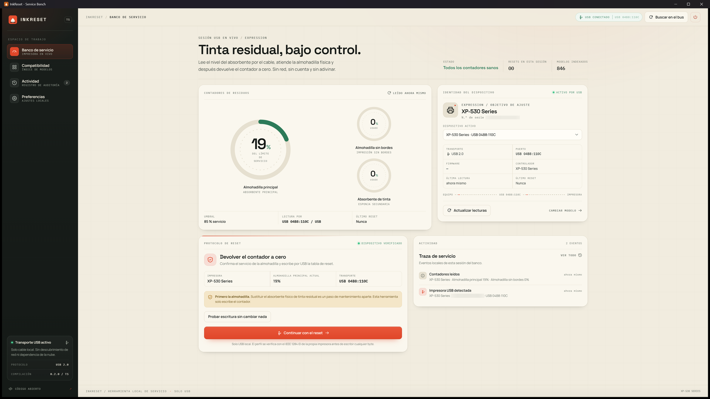
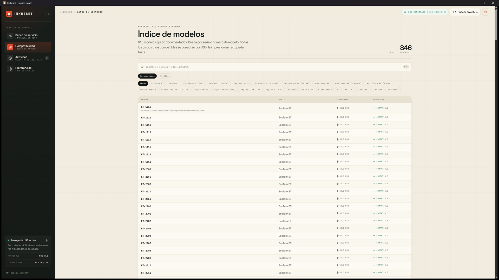
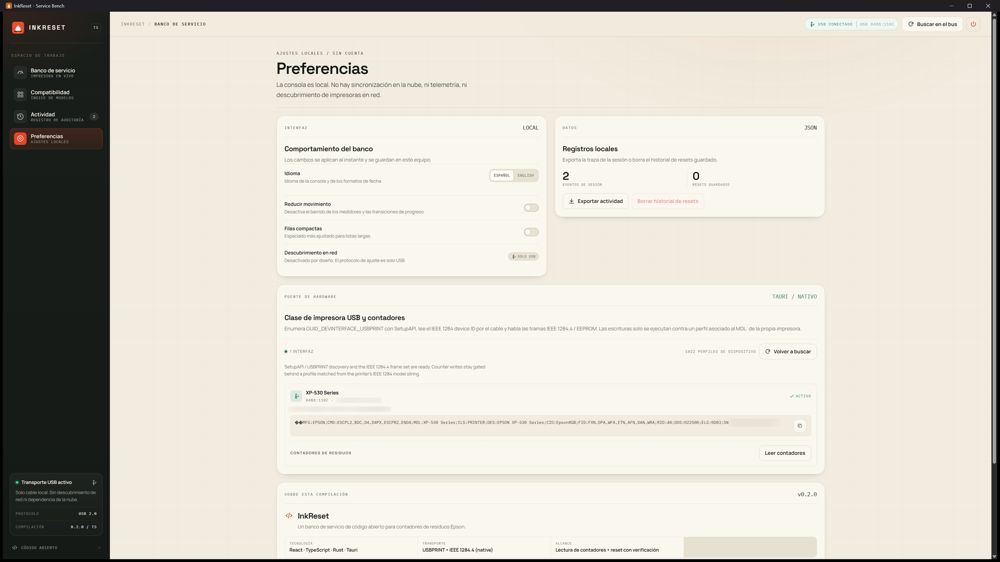
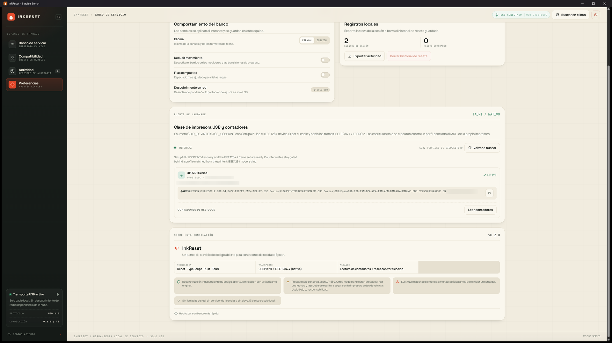

<p align="center">
  
</p>

<h1 align="center">InkReset</h1>

<p align="center">
  <a href="https://github.com/datacas/inkreset/releases/latest"><strong>Download the latest Windows release</strong></a>
</p>

<p align="center">
  <a href="https://github.com/datacas/inkreset/releases/latest"></a>
  <a href="https://github.com/datacas/inkreset/actions/workflows/ci.yml"></a>
  
  
  
</p>

<p align="center">
  <strong>English</strong> · <a href="README.es.md">Español</a>
</p>

InkReset is an open-source desktop utility that reads and resets the **waste-ink
counters** of Epson printers over USB. It talks to the printer directly through
IEEE 1284.4 and the Epson EEPROM service commands — no vendor account, no licence
key, no activation server and no network access.

> **A counter reset is not maintenance.**
> Resetting the counter does **not** clean, replace or empty the physical waste-ink
> absorber. Service the pad first. Resetting a saturated pad can make ink overflow.

## Tested hardware

InkReset has only been tested end to end on an **Epson XP-530** (`MDL:XP-530 Series`):
reading both waste counters and the safe write test. The embedded database covers many
other Epson models and the protocol should work on them, but **those models are
untested**.

If you use a different printer, run a read and the safe write test first, and reset at
your own risk. The authors accept no responsibility for damage caused to other
printers.

---

## Features

- **Automatic discovery.** On launch, InkReset enumerates USB printer interfaces,
  reads the IEEE 1284 device ID and resolves the matching device profile from the
  embedded database.
- **Real counter readings.** Every waste counter exposed by the model is read over
  USB, with the raw register values and the printer's own full-scale value.
- **Gated reset.** A reset only runs when the model has a verified reset table, the
  hardware still reports the same `MDL:` string, and the user types that model
  string exactly. The counters are re-read afterwards to verify the write.
- **Safe write test.** A dedicated self-test writes one EEPROM byte back unchanged,
  proving the whole write path works without altering any data.
- **Bilingual UI.** Spanish by default, English available in Settings.
- **Local only.** Settings and reset history live in `localStorage`. There is no
  telemetry, no remote logging and no outbound request.
- **Headless probes.** The same native core can enumerate printers and read counters
  from the command line, without opening the window.

## Screenshots



| Model index | Settings and hardware bridge |
| --- | --- |
|  |  |



## Stack

| Layer | Technology |
| --- | --- |
| UI | React 19, TypeScript, Vite |
| Desktop shell | Tauri 2 |
| Native bridge | Rust |
| USB transport | Windows SetupAPI / `USBPRINT` + overlapped `ReadFile` / `WriteFile` |
| Printer protocol | IEEE 1284.4 session + Epson EEPROM service commands |

The front end renders inside the Tauri WebView. Every scan, read and reset is a real
USB transaction performed by the Rust bridge; the web layer only describes intent.

## How the protocol works

InkReset implements the IEEE 1284.4 session used by Epson service tools:

1. Enter 1284.4 mode.
2. Initialise the session and resolve the service name to a socket id.
3. Open a channel with the packet sizes declared by the device profile.
4. Exchange credit grants and requests, then send one data packet per EEPROM byte.
5. Close the channel and leave 1284.4 mode.

The EEPROM command carried inside a data packet is:

```
read : 7C 7C <len8> 00 <factory LE16> 41 BE A0 <addr_lo> [addr_hi]
write: 7C 7C <len8> 00 <factory LE16> 42 BD 21 <addr_lo> [addr_hi] <value>
```

The printer answers a read with `EE:<addr><value>` and a write with `OK`. Control
replies carry the status byte and, for `0x7F` frames, the printer error id. An
already-open channel (`0x03`) is treated as success; a busy channel (`0x04`) is
retried a bounded number of times.

Per model, a chain of spec keys supplies the service block (factory token and
service name), the waste counters (`registers`, `mask`, `shift`, `filter`) and the
reset table of `(address, value)` pairs. The embedded database ships **1,022 printer
records** and **371 spec keys**, of which roughly 930 resolve to a usable service
block.

## Requirements

- Windows 10 or 11 (the native USB bridge is Windows-only)
- WebView2 runtime
- Node.js 20+
- Rust stable with the MSVC toolchain
- Visual Studio Build Tools with the Windows SDK

On Linux and macOS the front end builds and the app runs, but the bridge reports
itself as unavailable and no device is contacted.

## Build and run

```bash
npm install

npm run dev          # UI only in a browser (no USB access)
npm run tauri:dev    # native shell with the real USB bridge
npm run tauri:build  # release executable and installer
```

A release build must embed the front end. Tauri does this through the
`custom-protocol` feature:

```bash
cargo build --release --features custom-protocol
```

## Command line

```bash
inkreset-studio.exe --probe
inkreset-studio.exe --probe --read-counters
inkreset-studio.exe --self-test
inkreset-studio.exe --raw-session --sockets 0A,FF --names EPSON-CTRL,EPSON-DATA
```

| Flag | Purpose |
| --- | --- |
| `--probe` | Enumerate USBPRINT interfaces and write `%TEMP%\inkreset-probe.json` |
| `--probe --read-counters` | Also run the read-only 1284.4 session and embed the counters |
| `--self-test` | Write one EEPROM byte back unchanged and report the result |
| `--raw-session` | Dump the 1284.4 handshake frame by frame; never writes EEPROM |

All commands print JSON to stdout and write the same report under `%TEMP%`.

## Safety model

- **Device-verified profile.** The model string is re-read from the printer's IEEE
  1284 ID before a write; the webview cannot supply it.
- **Typed confirmation.** The user must type the exact `MDL:` string.
- **No reset table, no write.** Models with a service block but no reset data are
  read-only.
- **Verification after write.** Counters are read again and returned with the reset
  result.
- **Persistent warning.** The UI and every report state that a counter reset does
  not service the physical waste pad.

## Project layout

```
src/
├─ App.tsx                     # settings + i18n provider
├─ Bench.tsx                   # service bench UI shell
├─ components/                 # gauges, panels, dialogs, model index
├─ hooks/usePrinterSession.ts  # device state and session history
├─ services/bridge/            # invoke() wrappers and PrinterTransport
├─ i18n/                       # typed Spanish/English dictionary
└─ styles/global.css           # design system

src-tauri/
├─ src/protocol/mod.rs         # 1284.4 frames, EEPROM codec, reply decoding
├─ src/spec_db.rs              # embedded device database
├─ src/specs.json              # printer records and spec keys
├─ src/usb/windows.rs          # SetupAPI enumeration and overlapped transport
├─ src/usb/ieee1284.rs         # IEEE 1284 device-ID parser
├─ src/commands.rs             # Tauri commands
└─ tauri.conf.json             # window and bundle configuration
```

## Tests

The protocol module has no third-party dependencies, so it can be tested on its own:

```bash
rustc --edition 2021 --test src-tauri/src/protocol/mod.rs -o /tmp/proto-test
/tmp/proto-test
```

On Windows, `cargo test` in `src-tauri/` also covers the device database, the IEEE
1284 ID parser and the full read/reset session against a stateful fake printer.

## Limitations

- **USB only.** Printers attached through EpsonNet or WSD do not appear.
- **Epson only.** The device database covers Epson models.
- **Raw register values.** The `mask` and `shift` fields are applied, but the
  percentage formula used by some filter entries is not reconstructed; the UI shows
  the raw register value and the printer's full-scale value.
- **The model index is a curated reference list**, not a guarantee that every listed
  model exposes readable or resettable counters.
- **Only the Epson XP-530 has been verified on hardware.** Other models should work
  but must be tested by the user before a reset.

## License

MIT — see [LICENSE](LICENSE).

---

**Always replace or service the physical waste-ink absorber before resetting a
counter.**
